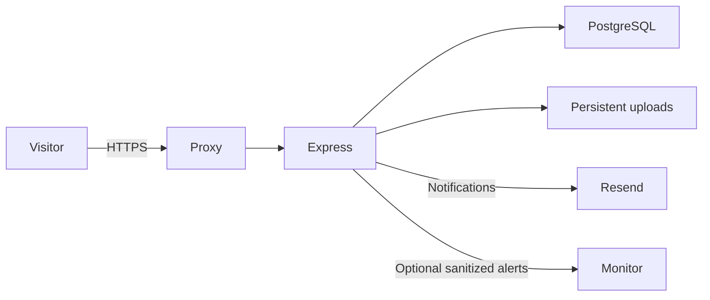

# Devfolio deployment and recovery

Devfolio runs one Node 22 web process behind an HTTPS reverse proxy, with PostgreSQL and persistent upload storage. Run a single scheduler instance: the same process handles daily cleanup, analytics retention and link checks. Local development can use Resend's test sender; production needs a verified sending domain.



## Local and staging setup

Use Node 22.12+ in the Node 22 line, PostgreSQL and a Resend sending key. From `backend`, run `npm ci`, create `.env` from `.env.example` if it does not already exist, set `DATABASE_URL`, `JWT_SECRET` and `RESEND_API_KEY`, then run `npx prisma migrate deploy`, `npx prisma generate` and `npm run dev`. Keep the environment file private. For development only, `RESEND_FROM` may be omitted. Test against a separate PostgreSQL database configured as `DATABASE_URL_TEST`; run `npm run migrate:test` before `npm test`.

For staging, use separate credentials, database, upload volume, origin and sender. Use the same image and proxy settings planned for production. Do not use live data in local tests. Apply migrations before starting the updated runtime. Smoke-check the staging URL, including a known published portfolio, before releasing the same image to production.

## Production options

For a managed container platform, build the `runtime` target from the repository root. Use the `migrate` target for a separate migration job, with the same production database connection string. Use managed PostgreSQL and its recommended TLS/certificate settings; a pooled connection may need a separate direct connection for migrations and backups. Mount persistent storage at `/data/uploads`. Route HTTPS to the app's port 5000, use `/healthz` for readiness and set `TRUST_PROXY` to the actual number of trusted proxies. Avoid exposing the Node port publicly alongside the proxy.

For a self-hosted server, `compose.yaml` provides a private PostgreSQL service, named volumes, a separate migration job, and an optional Caddy HTTPS proxy. In the repository root, copy `deploy/production.env.example` to `.env.production`, set mode 600 and fill in real values. Use a random database password and independent `JWT_SECRET`; do not commit the environment file. `DATABASE_URL` must use the same database password, URL-encoded if needed. Set `APP_DOMAIN`, matching `APP_URL=https://...`, the verified `RESEND_FROM`, and `RESEND_API_KEY`. Point the domain to the server and allow ports 80/443 for Caddy. The app port remains bound to loopback on the host.

```sh
docker compose --env-file .env.production --profile tools run --rm migrate
docker compose --env-file .env.production --profile tls up -d app proxy
docker compose --env-file .env.production ps
```

The Compose model can be validated without exposing real values: `docker compose --env-file deploy/production.env.example config --no-env-resolution --quiet`. Avoid printing resolved production configuration, which can contain secrets. The image runs Node as a non-root user and handles SIGTERM. The app emits request IDs, redacts token/cookie/body/query data in logs, and can post sanitized error-spike events to `ERROR_WEBHOOK_URL`. Configure monitoring for readiness, response latency, error spikes, storage capacity and scheduled job failures.

## Backups and recovery

Schedule PostgreSQL backups daily and keep encrypted off-site copies. Take coordinated snapshots of the upload volume as well: a database dump is consistent within PostgreSQL, but a separate file copy can race with upload replacement. Pause changes or use your provider's coordinated snapshot procedure when consistency matters. Use PostgreSQL client tools compatible with the server version.

On a host with a direct database connection, run `npm run backup` in `backend`. It reads `BACKUP_DATABASE_URL` or `DATABASE_URL`, copies uploads from `UPLOAD_DIR` when available, and stores an archive, optional file copy and manifest under `BACKUP_DIR` (default `backend/backups`). Backup directories and dumps are private. Schedule this command with your provider's job runner, cron or the example systemd timer in `deploy`. For Compose's private DB, you can run `pg_dump` inside the `db` service and redirect output to a mode-600 file in a private backup directory; back up the uploads volume separately. Never commit backups or put database passwords on command lines.

Restore into a **new, empty database**. Set `RESTORE_DATABASE_URL` locally and run `npm run restore -- /path/to/database.dump` from `backend`. The script refuses the configured source, main and test databases, does not use `--clean`, and restores in one transaction. Check expected rows and migration status, restore the matching upload snapshot, apply any missing migrations and verify readiness/smoke checks before switching traffic. Keep the prior database available for rollback. Test recovery periodically without touching production.

## Launch acceptance

- Confirm staging and production URLs, HTTPS, persistent uploads, migrations, `/healthz`, smoke checks and scheduled jobs.
- Verify a real Resend sending domain, configure `RESEND_FROM`, and verify delivery to an owner-approved inbox. Development test-sender acceptance does not prove production delivery.
- Finalize operator contact information and review the privacy and terms copy before public launch.
- Require the GitHub `checks` job on the protected branch if you want failed checks to block merges. The workflow is included; remote branch protection and run status require repository access.
- Keep browser, axe and Lighthouse results explicitly deferred until browser testing is approved. Local HTTP and token-contrast tests do not substitute for those audits.

No production environment is created by the repository alone. Provisioning hosting, DNS, email, monitoring and backup scheduling requires access to the chosen services.
